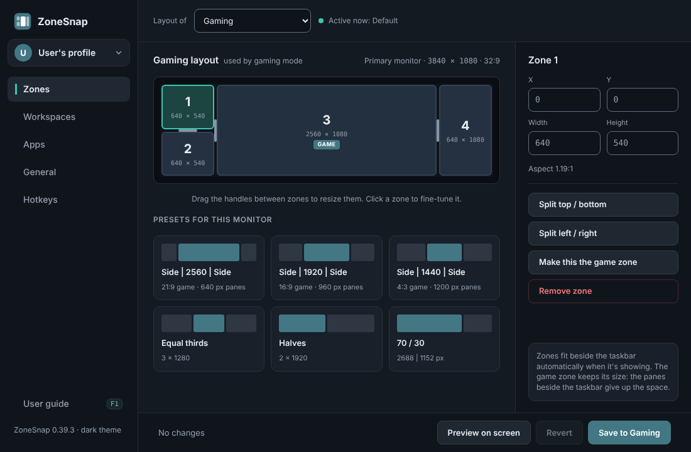
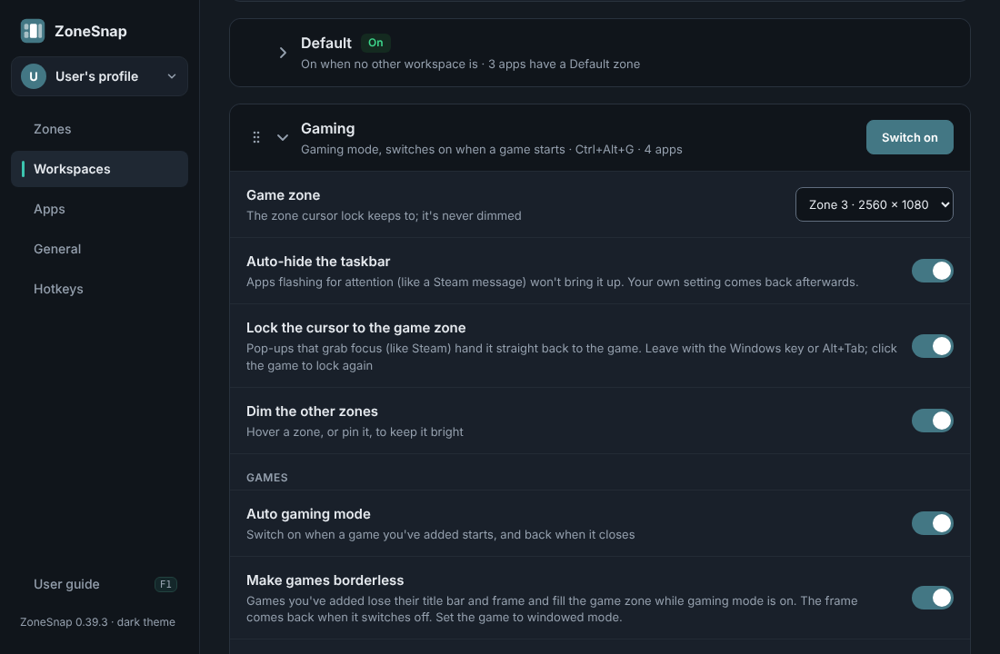
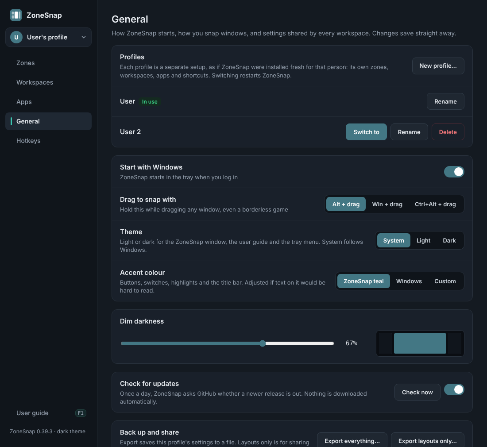
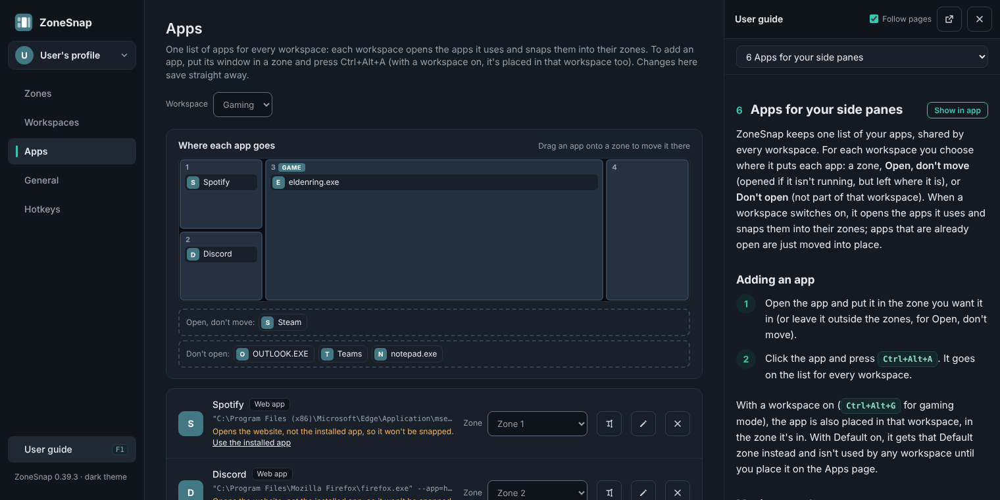

# ZoneSnap

> **Beta.** ZoneSnap is at 0.x: it works, but it's new and still changing. Please report problems in [Issues](../../issues).

**Window zones for ultrawide monitors, for work and play.** Draw zones, snap apps into them, and switch whole setups (Work, Streaming, Gaming) with one hotkey using workspaces. Gaming mode starts with your game: borderless, cursor lock, dimmed side panes, and per-game layouts like 4:3 for retro titles.

## Features

- **Zones you draw yourself.** A visual editor shows your monitor: drag the handles between zones to resize them, split zones, or start from presets sized for your screen (a 21:9, 16:9 or 4:3 game in the middle, thirds, halves, 70 / 30). Save layouts as profiles.
- **Snap anything, including borderless games.** Hold Alt and drag a window from anywhere inside it onto a zone, or press Ctrl+Alt+1–9.
- **Gaming mode** (Ctrl+Alt+G, or automatic when a game starts):
  - switches to your Gaming layout and auto-hides the taskbar,
  - makes your game borderless, fits it to the game zone and keeps it there,
  - opens your side apps (Discord, Spotify, a browser…) and snaps them into their panes,
  - locks the cursor to the game, so it can't wander onto the side panes or pop up the taskbar, and hands focus back to the game when a pop-up (like a Steam message) grabs it,
  - dims the side panes, with a pin button to keep a guide bright,
  - and when it switches off, puts your windows back where they were (or into the Default zones you choose).
- **Workspaces.** Save whole setups (a layout, apps to open and snap, and options) and switch between them with a hotkey or the tray: say *Gaming*, *Work* and *Streaming*. Gaming mode is the Gaming workspace, and **Default** is the one that's on when no other is. Every workspace is its own layout, edited on the Zones page. Rename, duplicate and drag workspaces into your own order, and press **Ctrl+Alt+Space** for a quick switcher at the mouse.
- **One app list, every workspace.** Add an app once and choose, for each workspace, which zone it goes in, Don't move, or Not used here, by dragging it on a map of the workspace's zones. The Apps page's Default view sets where each app goes when you're back on Default, so leaving gaming mode tidies your windows too. Rename any app (handy for web apps with odd names), edit how it opens, or remove it.
- **Profiles.** Sharing a PC and a Windows account? Each person gets a profile: a completely separate setup. Whose is on shows at the top of the window, where you switch between them. Separate Windows accounts get their own settings automatically.
- **Games and launchers.** Games you add in the game zone, or with **Add a game**, start auto gaming mode; launchers like Steam aren't mistaken for games. Give a game its own layout, such as 4:3 for a retro game, used automatically when it's running.
- **Taskbar-aware.** Zones fit beside the taskbar when it's showing and use the full screen when it's hidden; windows follow. A taskbar on the left or right of the screen is left showing, and your game zone keeps its exact size: the side pane next to the taskbar gives up the space.
- **Multi-monitor.** Zones on every monitor, remembered per monitor, so they survive rearranging, resolution changes and unplugging.
- **Your own shortcuts.** Change any keyboard shortcut on the Hotkeys page: click Change and press the keys.
- **A built-in user guide** that opens beside the ZoneSnap window (F1) and follows the page you're on.
- **Back up and share.** Export your settings to a file, or just your layouts to share them; import shows what a file holds first and backs up your settings.
- **Light or dark.** Follows Windows, or pick Light or Dark on the General page. A calm slate look with a teal title bar, or pick your own accent colour (or use your Windows one) for each profile.
- **Updates.** Once a day ZoneSnap checks this repository's releases and tells you when a new version is out. **Update now** downloads it, checks it's the release's own file, and restarts on it, with your settings as they were.

## Requirements

- Windows 10 or 11, with the Microsoft Edge WebView2 runtime (built into Windows 11 and up-to-date Windows 10).
- For the script version: [AutoHotkey v2](https://www.autohotkey.com/). The compiled `ZoneSnap.exe` needs nothing extra.

## Install

**Easiest:** download `ZoneSnap.exe` from the [releases page](../../releases) (beta versions are marked *Pre-release*), put it in a folder of its own and run it.

**Script version:** download the release zip (or clone this repository), keep `ZoneSnap.ahk`, `ZoneSnap.ico`, `ui.html`, `guide.html` and the `src` and `Lib` folders together, and double-click `ZoneSnap.ahk`.

On first run ZoneSnap looks at your monitor and sets up a starting layout, for example 640 | 2560 | 640 on a 3840×1080 screen or 840 | 3440 | 840 on 5120×1440, then opens its window with a short welcome. Turn on **Start with Windows** there if you want it running at login.

Your settings are saved in your Windows user folder, `%APPDATA%\ZoneSnap\profiles\<profile>\ZoneSnap.ini`, so each Windows account has its own; **Export everything** on the General page saves a copy anywhere you like. To update, choose **Update now** when ZoneSnap tells you about a new version, or exit ZoneSnap from the tray, replace the .exe (or the script files) and start it again; either way your settings carry over. (Before 0.37.0 they were in `ZoneSnap.ini` next to ZoneSnap: 0.37.0 moves them into a profile named after your Windows user name the first time it starts.)

## Quick start

1. **Hold Alt and drag** any window onto a zone.
2. Press **Ctrl+Alt+Z** to adjust your zones.
3. Press **Ctrl+Alt+G** to switch gaming mode on. Put Discord, Spotify or anything else in a side zone and press **Ctrl+Alt+A** to add it to gaming mode. Do the same with your game in the middle zone so ZoneSnap knows it's a game.
4. From then on, press **Ctrl+Alt+G** for gaming mode, or just start the game.

Press **F1** in the ZoneSnap window for the user guide.

## Hotkeys

| Shortcut | What it does |
| --- | --- |
| Alt + left-drag | Move any window (even a borderless game) and snap it to a zone |
| Shift while dragging a title bar | Show zones and snap on release |
| Ctrl+Alt+1 to 9 | Send the active window to that zone |
| Ctrl+Alt+Z | Open ZoneSnap on the Zones page |
| Ctrl+Alt+G | Gaming mode on/off |
| Ctrl+Alt+F1 to F9, or any key you choose | Switch one of your own workspaces on/off |
| Ctrl+Alt+A | Add the active window to your app list and place it in the active workspace (in the game zone, as a game); with Default on, give it a Default zone |
| Ctrl+Alt+L | Cursor lock on/off |
| Ctrl+Alt+F | Free the cursor from the game (press again to go back) |
| Ctrl+Alt+D | Dim side panes on/off |
| Ctrl+Alt+U | Keep the pane under the mouse lit |
| Ctrl+Alt+Shift+1 to 9 | Keep that zone lit |
| Ctrl+Alt+B | Remove or restore the active window's borders |
| Ctrl+Alt+Space | Quick switcher: pick a workspace from a list at the mouse |

These are the defaults. Every keyboard shortcut can be changed on the Hotkeys page of the ZoneSnap window (or under `[Hotkeys]` in the settings file), and the drag shortcut can be changed to Win or Ctrl+Alt + drag on the General page.

## Tips

- **Discord and Spotify have a minimum window size** that may be too big for a narrow side pane. Their web versions, installed as app windows in Microsoft Edge, don't: open `https://discord.com/app` (or `https://open.spotify.com`) in Edge, choose **Apps → Install this site as an app**, then open the installed app, put it in a zone and press Ctrl+Alt+A. ZoneSnap opens the installed app the way the Start menu does (a command with `--app=https://…` opens the website instead, which can't be snapped).
- **Games must be windowed or borderless.** Nothing outside a game can move an exclusive-fullscreen window. Set the game to windowed mode at your game zone's size; gaming mode removes its title bar and frame for you.
- **A game running as administrator** needs ZoneSnap running as administrator too (tray → Restart as administrator).
- **If the ZoneSnap window won't open,** ZoneSnap says why (usually the WebView2 runtime is missing) and keeps working from the tray and its shortcuts.
- **Update check:** set the repository (owner/name) on the General page. GitHub only answers for public repositories.

## Building the .exe

1. Install AutoHotkey v2 and its compiler (open AutoHotkey Dash → Compile; it offers to install Ahk2Exe).
2. Keep `ZoneSnap.ahk`, `ZoneSnap.ico`, `ui.html`, `guide.html`, `src` and `Lib` together. Ahk2Exe stops with an error if a bundled or included file is missing.
3. Compile `ZoneSnap.ahk` with the **64-bit v2** base. The .exe includes the icon, the interface, the user guide and the WebView2 loader.

GitHub does this too. Every pull request into `main`, and every merge to `main`, runs the **Build** workflow (Actions tab):

- **Checks:** static checks of the AutoHotkey code, repository checks and the window tests (see [tests](tests/README.md)).
- **Build:** loads the script under AutoHotkey v2 on Windows and compiles `ZoneSnap.exe`, kept with the run for 14 days.

To draft a release of the current version, with the .exe, the script zip and that version's changelog, run the workflow by hand on `main` with **Draft a release** ticked. Drafts are private until you publish them.

## Making a change

Changes never go straight to `main`: make a branch, then open a pull request into `main` once the steps below are done. It's merged (squash and merge) once Checks and Build pass.

1. Change the code, then bump the version: `ZS_VERSION` and `;@Ahk2Exe-SetVersion` in `ZoneSnap.ahk`, and `version:` in `ui.html`'s demo data. Use a new minor version for features or removals, and a patch version for fixes.
2. Add a section to `CHANGELOG.md`, and update this README and the guide (`docs/guide/guide.src.html`) if anything you can see changed.
3. Run `python tools/screenshots.py`. It retakes the README and guide pictures from `ui.html`'s demo mode and rebuilds `guide.html`.
4. Run the tests: `python tests/static_check.py` and `python -m pytest tests` (setup in [tests/README.md](tests/README.md)).

## What's in this repository

| Path | What it is |
| --- | --- |
| `ZoneSnap.ahk` | Start here: globals, start-up, the files bundled into the .exe, and a map of the modules |
| `src/` | The rest of the app, one module per area: `Profiles` (where settings live; profiles), `Zones`, `Snapping`, `Workspaces`, `Apps`, `Games`, `Cursor`, `Dimming`, `Taskbar`, `Hotkeys`, `Tray`, `Theme`, `Switcher` (the quick switcher), `Window` (messages to and from `ui.html`), `ImportExport`, `Updates`, `Config` (defaults and helpers) |
| `ui.html` | The ZoneSnap window (WebView2): Zones, Workspaces, Apps, General and Hotkeys pages and the guide panel. Opened in a browser it runs on demo data |
| `guide.html` | The user guide, built from `docs/guide` by `tools/build_guide.py` (don't edit it directly) |
| `ZoneSnap.ico` | The app icon |
| `Lib/` | thqby's ahk2_lib (WebView2, JSON, Promise, ComVar) and the WebView2 loader |
| `docs/screenshots/` | The pictures on this page |
| `docs/social-preview.png` | The picture shown when the repository's link is shared (made by `tools/screenshots.py`) |
| `docs/guide/` | The user guide's source and pictures |
| `tools/` | `build_guide.py` (builds `guide.html`), `screenshots.py` (retakes every picture), `requirements.txt` |
| `tests/` | Static checks, repository checks and window tests ([tests/README.md](tests/README.md)) |
| `.github/` | The Build workflow (`workflows/build.yml`: checks, the Windows build and draft releases), issue templates, and Dependabot settings |
| `CHANGELOG.md` | What changed in each version |
| `LICENSE` | The licence (MIT) |
| `CLAUDE.md` | Working notes for Claude sessions on this repository |

## Licence

ZoneSnap is released under the [MIT licence](LICENSE): you can use, change and share it freely, as long as the copyright notice and licence go with it.

## Credits

The ZoneSnap window uses [thqby's ahk2_lib](https://github.com/thqby/ahk2_lib) (WebView2, JSON, Promise and ComVar, MIT licence; see `Lib/LICENSE-ahk2_lib.txt`) and Microsoft's WebView2 loader (redistributed under the Microsoft Edge WebView2 SDK licence). They keep their own licences, which ship with them in `Lib`.
